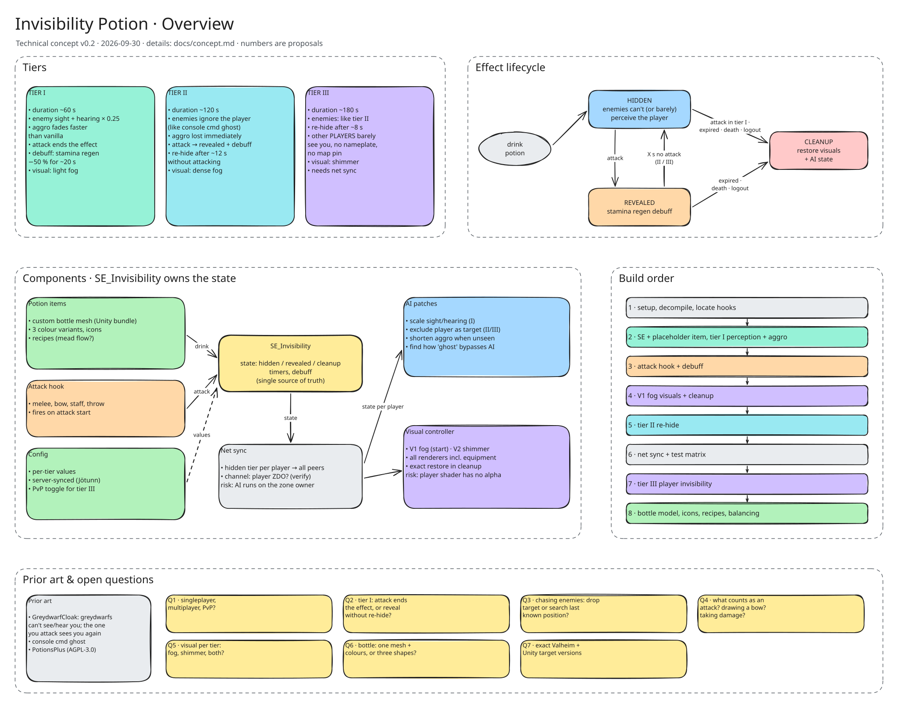

# Invisibility Potion (Valheim mod)

Status: 0.4.2 in preparation (smaller download, no gameplay change); 0.4.1 is the current release on Thunderstore and Nexus ([publishing](docs/publishing.md)), see the [changelog](InvisibilityPotion/Package/CHANGELOG.md). Tested in singleplayer; tier III hiding and the goggles passed with two clients on a dedicated server (2026-10-03). 0.4.1 was released without an in-game run and 0.4.2 has not been run in game yet: the open checks are in [docs/testing.md](docs/testing.md). Licence: MIT.

Three potions that hide the player from enemies. Attacking reveals the player and slows stamina regeneration. Higher tiers re-hide after a short time and also hide the player from other players.

- [Design spec](docs/superpowers/specs/2026-09-30-invisibility-potion-design.md) – the approved design, start here
- [Technical concept](docs/concept.md) – original draft the spec grew from
- [Overview sketch](docs/overview.excalidraw) – open in Excalidraw (the SVG also contains the scene)
- [Decision records](docs/decisions/)
- [Mod compatibility](docs/compatibility.md) – patches, prefab changes, known interactions
- [Dedicated server](docs/server.md) – BepInEx + Jötunn setup and deploy scripts
- Player-facing description: [Package/README.md](InvisibilityPotion/Package/README.md), Thunderstore wiki pages: [docs/wiki/](docs/wiki/)

## Targets

Valheim 1.0.17 (1.0.20 and 1.0.21 are out and not checked yet, see [testing](docs/testing.md)) · Unity 6000.0.75f1 · BepInEx 5.4.23.5 (BepInExPack_Valheim 5.4.2350) · Jötunn 2.30.0 (clients must run the same Jötunn patch version as the server, see [compatibility](docs/compatibility.md#7-version-matrix))

## Development

Linux, CLI only. Install `dotnet-sdk-8.0`, then `make help`. `make run` starts the game through Steam, which needs a one-time launch option on Valheim: `./start_game_bepinex.sh %command%`. See `CLAUDE.md` for the workflow and `docs/testing.md` for the in-game checklist.
